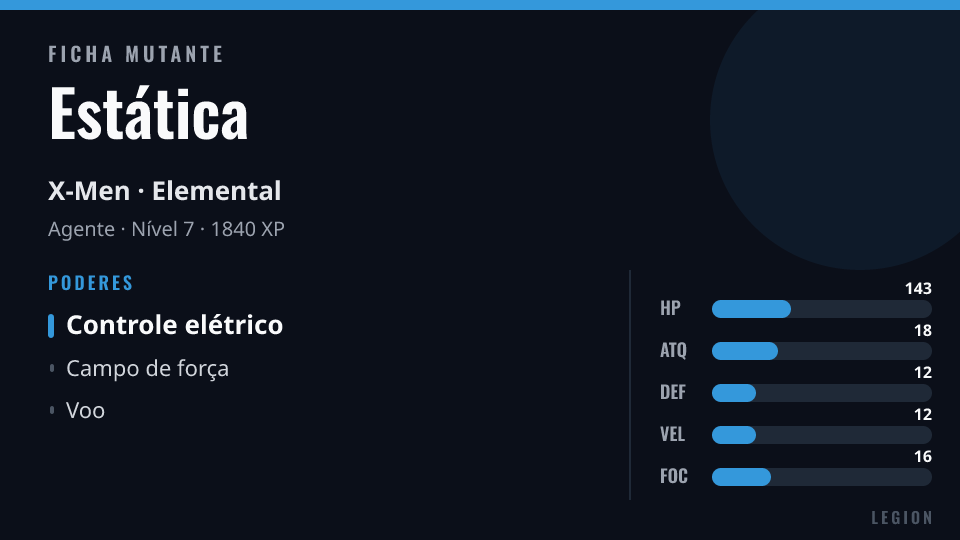

# Legion

Kit de bots de RPG para Discord, **auto-hospedável**, inspirado nos X-Men. Um único container roda cinco "bots" (personas) que compartilham um banco de dados:

| Bot | Papel | Versão |
|---|---|---|
| **Cérebro** | Recepção, cadastro do mutante (ficha com poderes e cartão), facções e cargos | v0.1.0 ✅ |
| J.A.R.V.I.S. | XP, níveis, ranks, trivia, missões | v0.2.0 ✅ |
| H.E.R.B.I.E. | Tutorial, ajuda e dicas | v0.3.0 ✅ |
| Sentinel | Combate e moderação | v0.4.0 ✅ |
| ULTRON | Eventos mundiais e raids | v0.4.0 ✅ |



**Primeira vez?** Siga o [TUTORIAL.md](TUTORIAL.md): do zero ao primeiro jogo, com uma conferência no fim de cada passo. Site do projeto: [uminocelo.github.io/legion](https://uminocelo.github.io/legion/).

## Início rápido (3 passos)

1. **Crie o app Cérebro no Discord** (detalhes abaixo) e copie o token, o Application ID e o ID do seu servidor.
2. **Configure:**
   ```bash
   git clone https://github.com/uminocelo/legion && cd legion
   cp .env.example .env                              # CEREBRO_TOKEN, CEREBRO_CLIENT_ID, DISCORD_GUILD_ID
   cp legion.config.example.yaml legion.config.yaml  # preencha os canais
   ```
   Ou responda às perguntas: `docker run --rm -it -v "$PWD:/out" ghcr.io/uminocelo/legion legion init --out /out`
3. **Suba:**
   ```bash
   docker compose up -d
   docker compose run --rm legion legion doctor
   ```

Guia passo a passo para quem não é desenvolvedor (Windows, macOS, Linux, Raspberry Pi): [docs/SELF_HOSTING.md](docs/SELF_HOSTING.md).

## Criar o app no Discord

1. Abra o [Developer Portal](https://discord.com/developers/applications) → **New Application** → nome **Cérebro**.
2. **General Information** → copie o **Application ID** → `CEREBRO_CLIENT_ID`.
3. **Bot** → **Username** Cérebro (o nome que aparece no chat) → **Reset Token** → copie → `CEREBRO_TOKEN` (nunca compartilhe).
4. **Bot → Privileged Gateway Intents** → ligue **Server Members Intent** (o Cérebro precisa para ver quem entra) e salve.
5. No Discord, ative **Configurações → Avançado → Modo desenvolvedor**, clique com o botão direito no servidor → **Copiar ID** → `DISCORD_GUILD_ID`.

## Convidar o bot

```bash
docker compose run --rm legion legion invite-url
```
Abra o link. Ele já pede só as permissões que os bots ligados usam (gerenciar cargos e canais, ver canais, enviar mensagens, embeds, tópicos, fixar mensagens, comandos de barra e, com o Sentinel, moderar membros).

### ⚠️ Suba o cargo do bot

O Discord só deixa um bot dar cargos **abaixo** do cargo mais alto dele. Em **Configurações do servidor → Cargos**, arraste o cargo do bot (**Cérebro**, o nome do app) para **acima** de todos os cargos que o Legion gerencia (Sinal Detectado, Mutante Registrado, as nove equipes (Independente, X-Men, Irmandade, Vingadores, S.H.I.E.L.D., Guardiões, Defensores, Thunderbolts, Filhos da Meia-Noite), Recruta, Agente, Veterano, Aviso de Live, Vanguarda, Duelista, Estrategista). `legion doctor` e `/cerebro status` listam exatamente quais estão acima dele.

O cargo **Assinante TikTok** é da integração do TikTok: o Legion nunca cria, edita, dá ou tira esse cargo.

## Variáveis de ambiente (`.env`)

| Variável | Obrigatória | Padrão | Para quê |
|---|---|---|---|
| `CEREBRO_TOKEN` | sim | — | Token do app principal (o do Cérebro; os outros bots usam ele se não tiverem app próprio). Antes se chamava `DISCORD_TOKEN`, que ainda funciona |
| `CEREBRO_CLIENT_ID` | sim | — | Application ID desse app. Antes `DISCORD_CLIENT_ID`, que ainda funciona |
| `DISCORD_TOKEN` + `DISCORD_CLIENT_ID` | não | app do Cérebro | Nomes antigos do app principal. Junto com `CEREBRO_*`, viram o app compartilhado pelos bots sem app próprio |
| `DISCORD_GUILD_ID` | sim | — | ID do servidor |
| `<BOT>_TOKEN` + `<BOT>_CLIENT_ID` | não | — | App próprio para um bot, ex. `JARVIS_TOKEN` e `JARVIS_CLIENT_ID` ([um app por bot](docs/SELF_HOSTING.md#um-app-por-bot-opcional)) |
| `DATABASE_URL` | não | `file:./data/legion.db` | SQLite (padrão) ou `postgres://…` |
| `LOG_LEVEL` | não | `info` | `debug`, `info`, `warn`, `error` |
| `HEALTH_PORT` | não | `8080` | `GET /healthz` |

Todo o resto fica em `legion.config.yaml` — veja [docs/CONFIG.md](docs/CONFIG.md).

## Comandos

- `docker compose up -d` — inicia (e reinicia sozinho se cair).
- `docker compose run --rm legion legion doctor` — confere tudo e diz como corrigir cada ❌ (`--json` para scripts).
- `docker compose run --rm legion legion register-commands` — registra os comandos de barra agora.
- `docker compose exec legion legion playtest-report --since 3h` — resumo do que aconteceu (missões, XP, lutas, conteúdo da staff) e se XP e limites batem. Roteiro de uma sessão de teste com amigos: [docs/PLAYTEST.md](docs/PLAYTEST.md).
- `docker compose run --rm legion legion content validate data/content` — confere arquivos de conteúdo (trivia, missões, campanhas, inimigos, poderes, itens) com as mesmas regras dos bots, sem usar o banco. Aceita arquivos ou pastas; `--type` força o tipo, `--categories` muda as categorias de trivia aceitas, `--json` para scripts. Sai com 0 (tudo certo), 1 (erros) ou 2 (tipo desconhecido).
- `docker compose logs -f` — logs.

No servidor: `/trivia`, `/ranking`, `/sequencia`, `/missao`, `/campanha`, `/carteira`, `/loja`, `/inventario` e `/jarvis` (com J.A.R.V.I.S.), `/ajuda`, `/regras`, `/tutorial`, `/idioma` e `/herbie` (com H.E.R.B.I.E.), `/cerebro setup` (staff; simula por padrão, `aplicar:true` para aplicar, `canais:true` para esconder canais de quem não se registrou), `/cerebro status`, `/perfil` (ficha com cartão em imagem), `/heroi` (`ficha`, `poderes`, `origem`; `/mutante` ainda funciona), `/cerebro preferencias`.

No cadastro, cada membro escolhe um poder principal (que define o arquétipo) e até dois secundários de um catálogo: veja [docs/POWERS.md](docs/POWERS.md).

## Atualizar

```bash
docker compose pull && docker compose up -d
```
As migrações do banco rodam sozinhas ao iniciar. Fixe uma versão com `LEGION_VERSION=0.9.1` no `.env` se preferir. Depois de atualizar, rode `/herbie guia publicar` para o guia fixado acompanhar as novidades.

## Backup

Tudo fica em `./data`. Pare (`docker compose stop`), copie a pasta `./data` e suba de novo. Com Postgres, use `pg_dump`.

## Ligar mais bots

Adicione o bot em `bots:` no `legion.config.yaml` (o Cérebro é sempre obrigatório) e reinicie. Disponíveis: `cerebro`, `jarvis`, `herbie`, `sentinel` e `ultron`.

### J.A.R.V.I.S. (trivia, XP e missões)

Com `bots: [cerebro, jarvis]`, rode `legion register-commands` (ou reinicie) e os membros registrados ganham:

- `/trivia [categoria]`: pergunta rápida e só sua (quadrinhos, Marvel Rivals, geral, Vingadores, Quarteto Fantástico, cósmico, místico). Acerto rápido vale mais XP; há limite diário.
- `/ranking [período] [facção]`: quem mais ganhou XP na semana (começa na segunda), no mês ou no total.
- `/sequencia`: dias seguidos com XP e o bônus de amanhã.
- `/perfil` passa a mostrar nível, XP e sequência. Ao cruzar 500 e 2000 XP, o Cérebro troca o cargo para Agente e Veterano.

- `/missao lista | iniciar | abandonar`: histórias curtas com escolhas, sozinho ou em grupo (até 4), num tópico do `channels.missions`. Missões com luta usam o ULTRON e o Sentinel. Diárias, semanais e de história, com XP e limites configuráveis. Para escrever as suas, veja [docs/MISSIONS.md](docs/MISSIONS.md).
- `/carteira`: seu saldo de créditos e as últimas movimentações. Missões, respostas certas na trivia e eventos do mundo pagam créditos ([docs/ECONOMY.md](docs/ECONOMY.md#créditos)).
- `/loja`: compre itens com créditos; a compra tira os créditos e entrega o item de uma vez ([docs/ECONOMY.md](docs/ECONOMY.md#loja)).
- `/inventario`: seus itens e três espaços (traje, acessório, dispositivo). Um item equipado dá um bônus pequeno nas lutas, com teto no total ([docs/ECONOMY.md](docs/ECONOMY.md)).
- `/campanha [campanha]`: missões em capítulos que liberam em ordem (missões anteriores, nível, origem, equipe), com o progresso de cada um. Cada equipe tem um arco de recrutamento a partir do nível 3, e há uma campanha com o Quarteto Fantástico ([docs/UNIVERSE.md](docs/UNIVERSE.md#arcos-de-recrutamento)).

Staff: `/jarvis xp` (ajuste manual com motivo), `/jarvis trivia nova | importar | lista | editar | desativar | ativar | exportar | recarregar | estatisticas`, `/jarvis missao importar | lista | desativar | ativar`, `/jarvis campanha importar`, `/jarvis recalcular` (refaz o progresso a partir do histórico). Crie perguntas e importe missões pelo próprio Discord: [docs/STAFF.md](docs/STAFF.md).

### H.E.R.B.I.E. (tutorial e ajuda)

Com `herbie` em `bots:`, quem termina o cadastro recebe uma DM do H.E.R.B.I.E. com um tutorial curto: a campanha **Primeiro contato** (ver o `/perfil`, três capítulos de missão com uma primeira luta, e uma `/trivia`), e no fim uma explicação das equipes e do `/campanha` ([docs/TUTORIAL.md](docs/TUTORIAL.md)). Cada passo dá XP pelo J.A.R.V.I.S. Se a DM estiver fechada, a mensagem vai para `channels.tutorial` (ou o canal de boas-vindas), mencionando a pessoa.

- `/ajuda [tópico]`: o que fazer agora (conforme o momento do membro) e a lista de comandos dos bots ligados.
- `/regras [termo]`: regras do servidor ou um termo do glossário, com autocompletar.
- `/tutorial [reiniciar]`: checklist do tutorial; também começa para quem já estava registrado antes.
- `/idioma`: português ou inglês; as respostas privadas de todos os bots seguem a escolha.
- Dicas diárias opcionais (desligadas por padrão) e explicação dos eventos do ULTRON.

Staff: `/herbie status` (funil do tutorial), `/herbie dica-agora` e `/herbie guia publicar` (posta e fixa o guia "como jogar", por padrão em `channels.rules`; publicar de novo atualiza a mesma mensagem). Tutorial, glossário e dicas podem ser personalizados: veja [docs/CONFIG.md](docs/CONFIG.md#herbie).

### Sentinel (combate e moderação)

Com `sentinel` em `bots:`:

- `/treino`: luta contra o Drone de Treino num tópico, com botões por rodada. Todo combate usa dados com semente e pode ser conferido pela staff com `/sentinel replay`. Regras e fórmulas em [docs/COMBAT.md](docs/COMBAT.md).
- `/combate status` e `/combate log <id>`.
- Limites de uso para todos os bots (a staff nunca é bloqueada), com sinais de abuso, XP fora do normal e contas novas.
- `/denunciar` e o menu **Denunciar mensagem** (clique direito na mensagem → Apps). As denúncias chegam em `channels.modQueue` com botões só para a staff: resolver, ignorar, avisar por DM, timeouts e histórico. O Sentinel nunca pune sozinho.

Staff: `/sentinel replay | denuncias | historico`. Para os timeouts, o cargo do bot precisa da permissão **Moderar membros**. Deixe `channels.modQueue` visível só para a staff.

### ULTRON (inimigos e eventos mundiais)

Com `ultron` em `bots:` (precisa do `sentinel`) e `channels.events` definido:

- Inimigos originais escalados para o nível do grupo em missões de combate; a staff testa com `/ultron spawn`.
- Invasão semanal (sábado 20:00 por padrão) em que todas as facções atacam o mesmo HP, e raids com chefe num tópico. Cada **Atacar** é uma luta rápida no Sentinel; vitória ou derrota dá XP pelo J.A.R.V.I.S.
- `/ameaca` para todos. Staff: `/ultron evento agendar | iniciar | cancelar`, `/ultron status`, `/ultron inimigo importar | lista | desativar | ativar` ([docs/STAFF.md](docs/STAFF.md)).
- Frases por IA opcionais (Ollama ou API compatível com OpenAI), desligadas por padrão.

Detalhes em [docs/WORLD_EVENTS.md](docs/WORLD_EVENTS.md).

## Skills para IA

A pasta [`skills/`](skills/) tem cinco skills que ensinam um agente de IA (Claude Code ou outro que leia Markdown) a escrever conteúdo do Legion: `legion-mission`, `legion-campaign`, `legion-trivia`, `legion-enemy` e `legion-setup`. O agente segue o formato, a regra dos nomes da Marvel, o equilíbrio e o estilo em pt-BR, e confere com `legion content validate` antes de entregar. A `legion-setup` nunca lê o `.env`. Baixe o pacote e veja como instalar em [uminocelo.github.io/legion/skills.html](https://uminocelo.github.io/legion/skills.html).

## Site

A página do projeto fica em [`website/`](website/): uma página por bot (com os comandos gerados do próprio código) um guia para [personalizar](https://uminocelo.github.io/legion/personalizar.html) missões, trivia, inimigos e textos, e editores no navegador para montar [missões](https://uminocelo.github.io/legion/editor-missoes.html), [perguntas](https://uminocelo.github.io/legion/editor-trivia.html) e [inimigos](https://uminocelo.github.io/legion/editor-inimigos.html) com as mesmas regras dos bots. Estático, sem chamadas externas: nada sai do navegador. Publicada em [uminocelo.github.io/legion](https://uminocelo.github.io/legion/) a cada mudança em `website/` no `main` (workflow `Pages`). Para ver localmente: `pnpm site:build` e abra `website/dist/index.html`. Detalhes em [website/README.md](website/README.md).

## Desenvolvimento

Node 22+, pnpm 10. `pnpm install && pnpm build && pnpm test`. Veja [CONTRIBUTING.md](CONTRIBUTING.md), [docs/ARCHITECTURE.md](docs/ARCHITECTURE.md) e [docs/EVENTS.md](docs/EVENTS.md).

## Marcas e personagens

Legion, Cérebro, H.E.R.B.I.E., J.A.R.V.I.S., ULTRON, Sentinel, X-Men e todos os outros nomes da Marvel pertencem à Marvel/Disney. Este é um **projeto de fã gratuito e sem fins lucrativos**, sem afiliação com a Marvel ou a Disney. Personagens canônicos não podem ser usados como identidade de jogadores ou inimigos: todo mutante é original. As histórias das missões podem citar heróis, equipes e lugares da Marvel ([docs/UNIVERSE.md](docs/UNIVERSE.md)).

## Apoie

O projeto é mantido apenas por doações e patrocínios (GitHub Sponsors, Ko-fi, Apoia.se, PIX — links em breve). Benefícios de apoiador são apenas cosméticos; nada que afete o jogo é vendido.

## Licença

**A definir.** O mantenedor vai escolher entre MIT e AGPL antes do primeiro lançamento público estável. Até lá, nenhuma licença é concedida além do que o GitHub permite para repositórios públicos.
