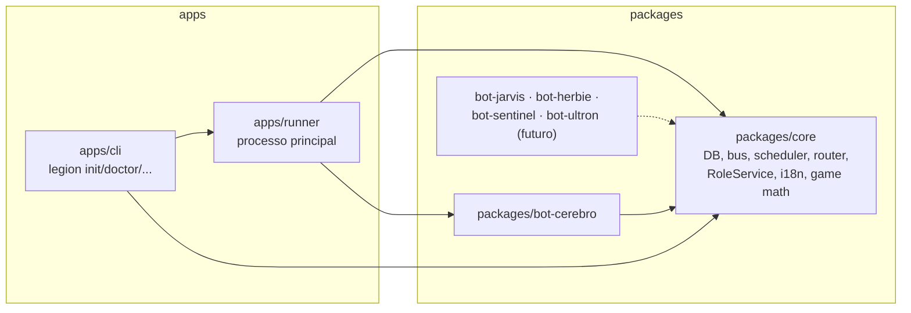
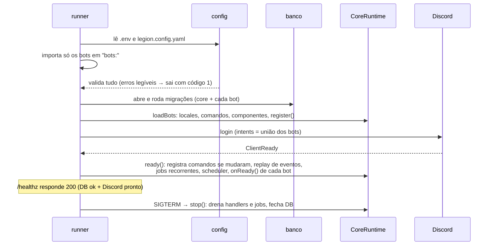
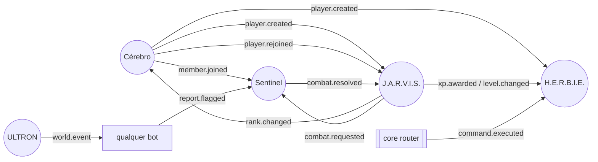
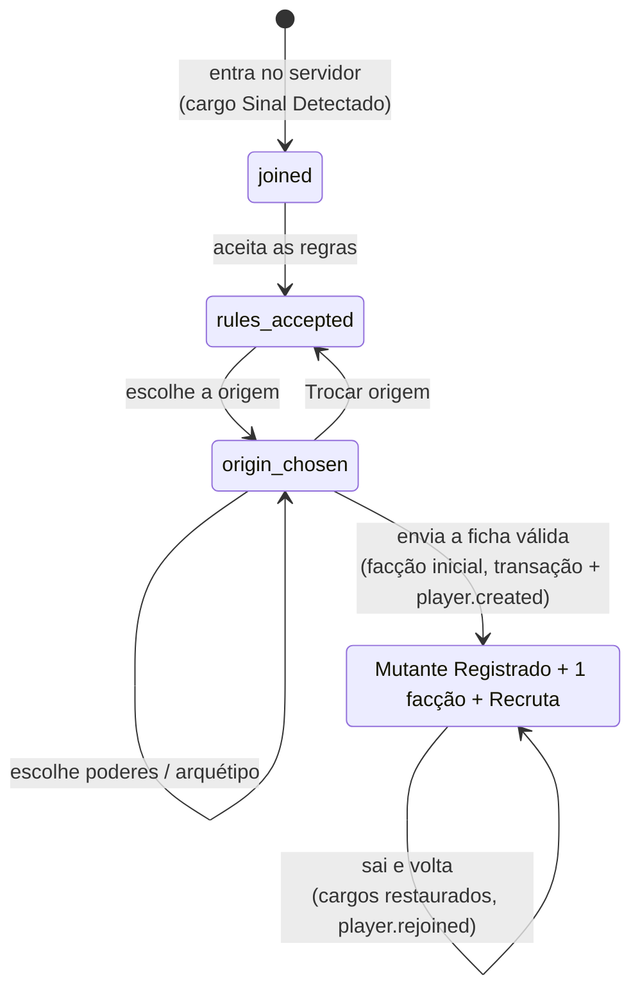

# Arquitetura

Um processo Node.js, uma conta de bot no Discord, um banco (SQLite ou Postgres). Cada "bot" é um módulo que o runtime carrega; eles nunca se chamam diretamente, só trocam eventos.

## Monorepo

## Boot do runner

## Fluxo de eventos

`bus.emit(tx, …)` grava o evento em `core_event_log` **na mesma transação** da mudança. Só depois do commit o evento é entregue (outbox). Entrega é *at-least-once*: cada consumidor registra `(consumerId, eventId)` em `core_event_consumption`; falhas são re-tentadas pelo scheduler (1s, 5s, 30s, 2m, 10m) e eventos não consumidos são reprocessados no boot.

Catálogo completo: [EVENTS.md](EVENTS.md).

## Cérebro: máquina de estados do cadastro

O passo fica em `members.onboarding_step`. Botões antigos ou repetidos nunca avançam nem voltam o estado: mostram a tela do passo atual.

Antes da v0.9 o terceiro passo era `faction_chosen`; a migração `0002_hero_origins` muda esses membros para `rules_accepted` (eles escolhem a origem e mantêm a facção). Veja o [ADR 0031](adr/0031-hero-origins.md).

Cargos são aplicados **depois** do commit. Se o Discord falhar, o banco continua certo e o job `cerebro.reconcile-member` acerta os cargos depois.

## Interações

Componentes usam ids `<bot>:v<versão>:<ação>:<args>`; um id desconhecido ou de versão antiga recebe "este botão expirou". Todo handler roda com limite de taxa e uma barreira de erro que responde `core.errors.generic` em vez de derrubar o processo. Ver [ADR 0001](adr/0001-node-typescript-over-elixir.md).
